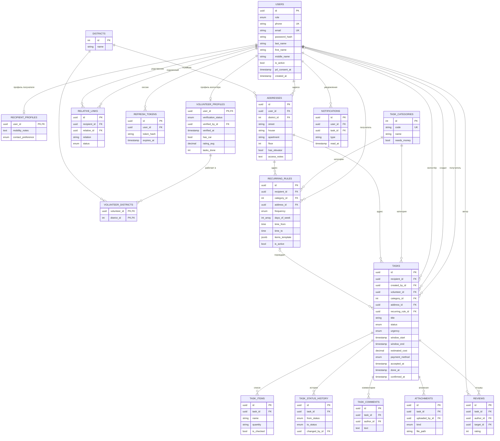
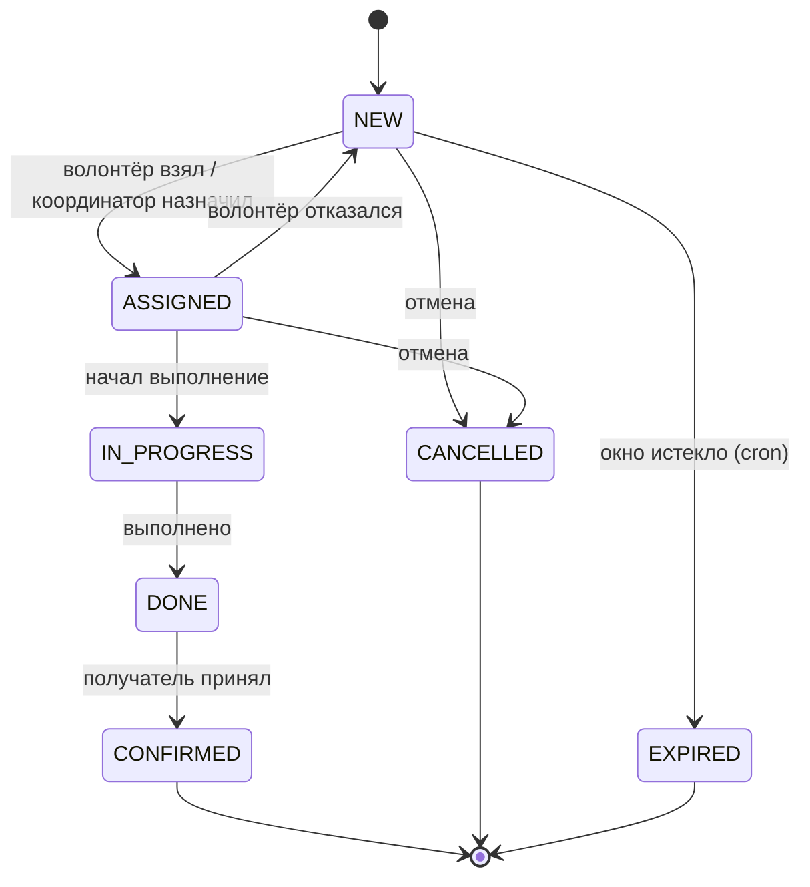

# ER-диаграмма «Иду на помощь!»

17 таблиц в четырёх группах. Источник правды — [`backend/prisma/schema.prisma`](../backend/prisma/schema.prisma).
Картинка для отчёта: [`er-diagram.png`](er-diagram.png) (или вставить код ниже в mermaid.live → PNG/SVG).

Центр схемы — `tasks`: к ней трижды привязан `users` (получатель, автор, волонтёр), от неё зависят
список, история, комментарии, вложения и отзывы.

## Жизненный цикл заявки

Реализация — [`backend/src/modules/tasks/task-status.machine.ts`](../backend/src/modules/tasks/task-status.machine.ts).
Каждый переход пишется в `task_status_history`.

## Ограничения целостности сверх схемы Prisma

Добавлены в миграцию `20261107000000_init` вручную:

| Ограничение | Смысл |
|---|---|
| `reviews_rating_check` | оценка 1–5 |
| `tasks_window_check` | конец окна позже начала |
| `tasks_volunteer_check` | у ASSIGNED / IN_PROGRESS / DONE всегда есть волонтёр |
| `recurring_rules_*_check` | день месяца 1–28, дни недели 1–7, время и период корректны |
| `relative_links_self_check` | нельзя быть родственником самому себе |
| `addresses_one_default_per_user` | не больше одного основного адреса |
